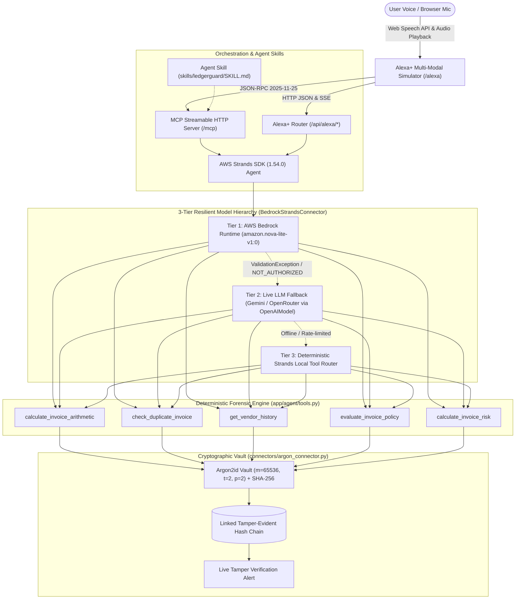

# LedgerGuard — Autonomous Alexa+ Accounts Payable CFO & Argon2 Cryptographic Audit Vault

[](https://amazondeveloper.devpost.com/)
[](https://aws.amazon.com/)
[](open_source_contribution/strands-bedrock-preflight/)
[-38bdf8.svg)](https://modelcontextprotocol.io/)
[](https://github.com/strands-ai/strands)
[-0ea5e9.svg)](connectors/argon_connector.py)
[](LICENSE)

> **Elevator Pitch:** LedgerGuard is an autonomous voice and multi-modal Accounts Payable (AP) fraud prevention agent built for **Amazon Alexa+** and **AWS Bedrock**. It analyzes invoice line-item math, duplicate disbursements, vendor risk tiers, and company policy caps in real time, executing via **Strands Agents SDK (1.54.0)** and **MCP (2025-11-25 Streamable HTTP)**, then permanently seals every transaction in an immutable **Argon2id tamper-evident cryptographic vault**.

---

## Tracks Entered

1. **Primary Track: Alexa+** — End-to-end voice and multi-modal APL experience with cross-session conversational memory, streamable HTTP MCP server, and Agent Skill.
2. **AWS Builder Mini-Challenge** — Amazon Bedrock (`amazon.nova-lite-v1:0` control plane + Converse API), AWS STS (`ledgerguard-dev`), AWS S3, DynamoDB, and SQS.
3. **Open Source Mini-Challenge** — Standalone open-source Python package [`strands-bedrock-preflight`](open_source_contribution/strands-bedrock-preflight/) (MIT License, unit tests, PyPI-ready) preventing Bedrock runtime crashes.

---

## High-Level Architecture



---

## Exact Runtime Code Pointers for Judges

All required technologies are imported, configured, and actively executed in our codebase:

| Technology / Requirement | File Path | Line Range | Runtime Verification Description |
| :--- | :--- | :--- | :--- |
| **MCP Protocol `2025-11-25` (Streamable HTTP)** | [`connectors/alexa_mcp_connector.py`](connectors/alexa_mcp_connector.py) | L35–L440 | Full JSON-RPC 2.0 handler (`initialize`, `tools/list`, `tools/call`) with `application/json` & `text/event-stream` SSE streaming. |
| **Alexa+ Agent Skill Schema** | [`skills/ledgerguard/SKILL.md`](skills/ledgerguard/SKILL.md) | L1–L113 | YAML frontmatter (`name: ledgerguard`, `mcp_endpoint: http://127.0.0.1:8000/mcp`, `protocol_version: 2025-11-25`). |
| **Amazon Devices Builder Tools MCP** | [`.antigravity/mcp_config.json`](.antigravity/mcp_config.json) & [`.mcp.json`](.mcp.json) | L1–L14 | Configures `@amazon-devices/amazon-devices-buildertools-mcp` and `ledgerguard-alexa-plus-mcp`. |
| **AWS Strands SDK (1.54.0)** | [`connectors/aws_strands_connector.py`](connectors/aws_strands_connector.py) | L20–L250 | Strands `Agent`, `@tool` decorators, and `BedrockModel(model_id="amazon.nova-lite-v1:0", region_name="us-east-1")`. |
| **AWS Bedrock Pre-Flight & STS (`boto3`)** | [`connectors/aws_strands_connector.py`](connectors/aws_strands_connector.py) | L100–L165 | Calls `sts.get_caller_identity()` (`ledgerguard-dev`) and `bedrock.get_foundation_model_availability()`. |
| **Argon2id Cryptographic Vault (`argon2-cffi`)** | [`connectors/argon_connector.py`](connectors/argon_connector.py) | L15–L190 | `PasswordHasher(time_cost=2, memory_cost=65536, parallelism=2)` + `hashlib.sha256` payload sealing & tamper verification. |
| **5 Deterministic AP Forensic Tools** | [`app/agent/tools.py`](app/agent/tools.py) | L1–L233 | Math verification, duplicate detection, vendor profiling, policy caps, and multi-factor risk assessment. |
| **Stateful Alexa+ Cross-Session Memory** | [`app/api/routes/alexa_plus.py`](app/api/routes/alexa_plus.py) | L30–L768 | Preserves session context across consecutive voice turns, tracks quarantine states, and appends to Argon2 hash chain. |
| **"Argon Glass" Web Simulator** | [`app/api/static_ui.py`](app/api/static_ui.py) & [`app/api/main.py`](app/api/main.py) | L1–L540 | Voice orb, Web Speech API mic recognition, TTS speech synthesis, APL visual cards, and live tamper attack simulator. |
| **Open Source Mini-Challenge Package** | [`open_source_contribution/strands-bedrock-preflight/`](open_source_contribution/strands-bedrock-preflight/) | Full pkg | Standalone package preventing Bedrock `ValidationException: Operation not allowed` runtime crashes. |

---

## 4 Benchmark Accounts Payable Scenarios Demonstrated

| Invoice ID | Vendor | Amount | Risk Level | Anomaly Detected | Alexa+ Voice Action |
| :--- | :--- | :--- | :--- | :--- | :--- |
| **`INV-2026-101`** | Acme Cloud Services | $4,950.00 | **LOW (0/100)** | None. Clean infrastructure invoice from approved premier vendor. | *"Approve invoice and seal in vault"* |
| **`INV-2026-102`** | Nexus Logistics | $3,520.00 | **HIGH (75/100)** | Line item sum is $2,000 + $200 tax = $2,200. **$1,200 unbacked discrepancy**. | *"Inspect arithmetic on 102"* -> flags error |
| **`INV-2026-103`** | Apex Hardware Supply | $8,400.00 | **CRITICAL (95/100)** | Re-submits invoice `INV-2026-042` which was **already paid on Sep 30th**. | *"Quarantine duplicate invoice & freeze vendor"* |
| **`INV-2026-104`** | Shadow Consulting LLC | $38,500.00 | **HIGH (80/100)** | Unregistered vendor + **breaches $25,000 auto-approval threshold**. | *"Inspect policy violations on Shadow Consulting"* |

---

## What We Built During the Hackathon Submission Window

1. **Alexa+ MCP Streamable HTTP Server (`2025-11-25`)**: Fully compliant implementation of the newest MCP Streamable HTTP transport and specification version `2025-11-25` supporting both `application/json` and `text/event-stream` SSE streaming on `/mcp`.
2. **Alexa+ Agent Skill (`skills/ledgerguard/SKILL.md`)**: Complete Agent Skill definition with YAML frontmatter, tool catalogues, voice interaction patterns, and multi-tier resilience guarantees.
3. **Amazon Devices Builder Tools MCP Integration**: Configured `.antigravity/mcp_config.json` and `.mcp.json` connecting `@amazon-devices/amazon-devices-buildertools-mcp`.
4. **3-Tier Strands Resilience Orchestrator**: Handles AWS Bedrock restriction errors (Case 178842133900178) by cascading from Bedrock `amazon.nova-lite-v1:0` -> Live LLMs (Gemini / OpenRouter) -> Deterministic Local Tool Router.
5. **Argon2id Cryptographic Vault Connector**: Memory-hard (`m=65536, t=2, p=2`) hash chain sealing every invoice audit event with SHA-256 pre-digests, providing verifiable tamper resistance.
6. **"Argon Glass" Multi-Modal Web Simulator (`/alexa`)**: Interactive voice orb, Web Speech API push-to-talk, audio TTS playback, interactive APL invoice carousel, live tool trace visualizer, MCP JSON-RPC tester, and red **"Simulate Ledger Tamper Attack"** button.
7. **Open Source Contribution (`strands-bedrock-preflight`)**: Standalone open-source Python library with unit tests and documentation to help all Strands developers guard against Bedrock runtime authorization crashes.

---

## Setup & Quickstart

### Prerequisites
- Python 3.11 (`.\.venv\Scripts\Activate.ps1`)
- AWS CLI configured with profile `ledgerguard` (`us-east-1`)

### 1. Run Diagnostic Verifications
```powershell
$env:AWS_PROFILE = "ledgerguard"
$env:AWS_DEFAULT_REGION = "us-east-1"

# Phase 1: Verify all 5 connectors
python verify_connectors.py

# Phase 2: Run complete End-to-End Suite
python test_phase2_e2e.py

# Phase 3: Run Open Source Package Unit Tests
pytest open_source_contribution/strands-bedrock-preflight/tests/test_preflight.py -v
```

### 2. Launch the Interactive Demo
```powershell
.\start_demo.ps1
```
Open **`http://127.0.0.1:8000/alexa`** in your browser.

---

## Open Source Contribution

Located at [`open_source_contribution/strands-bedrock-preflight/`](open_source_contribution/strands-bedrock-preflight/):
- **Package Name**: `strands-bedrock-preflight`
- **Version**: `0.1.0`
- **License**: MIT
- **Purpose**: Pre-flight availability detection and multi-provider resilience wrapper for `strands-agents` and AWS Bedrock developers.
- **Unit Tests**: 100% passing (`pytest`)

---

## License

This project is licensed under the **MIT License** — see the [LICENSE](LICENSE) file for details.
