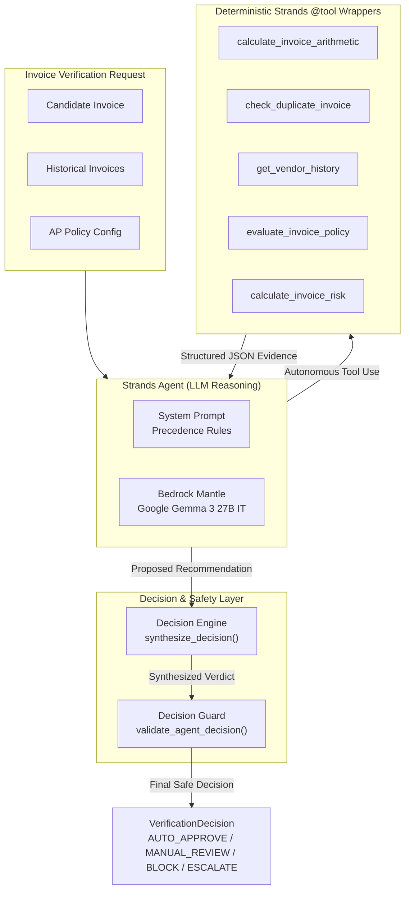

# LedgerGuard

LedgerGuard is an autonomous Accounts Payable (AP) invoice verification agent built with the **Strands Agents SDK**.

Core concept:
> "Let AI handle high-volume, repetitive invoice verification in the background, alerting humans only when genuine judgement is required."

## Architecture

LedgerGuard decouples the core verification agent from the underlying LLM provider through a Model Provider Abstraction layer:

```text
               +-----------------------+
               |   LedgerGuard Agent   |
               |     (Strands SDK)     |
               +-----------------------+
                           |
                           v
               +-----------------------+
               |     Model Factory     |
               +-----------------------+
                           |
                           v
               +-----------------------+
               |  Provider Abstraction |
               +-----------------------+
                 /         |                         /          |                         v           v           v
       +-------------+ +-------------+ +--------------------+
       |   Bedrock   | | OpenRouter  | |   Amazon Bedrock   |
       |   Mantle    | |(Development | |      Runtime       |
       |  (PRIMARY)  | | Alternative)| |(Auth Pending / AWS)|
       +-------------+ +-------------+ +--------------------+
```

- **LedgerGuard Agent**: Accounts-payable verification agent using Strands.
- **Model Factory**: Resolves the model provider from configuration without modifying agent code.
- **BedrockMantleProvider** (*Primary Development Provider*): Connects to Amazon Bedrock Mantle in `us-east-1` running Google Gemma 3 27B IT (`google.gemma-3-27b-it`) with dynamic SigV4-derived bearer tokens minted through AWS IAM credentials.
- **OpenRouterProvider** (*Explicit Alternative Provider*): OpenAI-compatible adapter for OpenRouter (`openai/gpt-4o-mini`) during development.
- **BedrockRuntimeProvider** (*Architectural Provider*): Traditional Amazon Bedrock provider prepared for AWS production deployment.

## Phase 2 ? Deterministic Invoice Verification Engine

**Core Principle**:
> *The LLM reasons over evidence, while deterministic tools verify financial facts.*

In AP invoice verification, AI models reason over unstructured document context and semantics, while all financial arithmetic, policy boundaries, duplicate checks, and risk metrics are verified by deterministic, side-effect-free tools.

### Key Architectural Characteristics
- **Strict Decimal Precision**: All monetary computations are performed using Python's `Decimal` quantized to `Decimal("0.01")` with `ROUND_HALF_UP`. Floating-point representations are strictly forbidden in data models and tools.
- **Multi-Currency Safety**: Monetary amounts are segregated by currency. The system explicitly prevents summing or aggregating across different currency codes without exchange rates.
- **Offline & Autonomous**: Phase 2 tools execute entirely offline without network access, LLM inference, or AWS/cloud dependencies.
- **Tolerant Extraction Modeling**: Incomplete invoices (e.g., partial OCR extraction with `subtotal=None` or `total=None`) are supported without validation errors, returning structured `INSUFFICIENT_DATA` verification statuses.

### Tools & Engines
1. **Invoice Domain Models** (`app/models/invoice.py`): Type-safe Pydantic models for `Invoice` and `LineItem` enforcing Decimal monetary quantities and half-up rounding.
2. **Verification Schemas** (`app/models/verification.py`): Structured enums (`VerificationStatus`, `DuplicateStatus`, `RiskLevel`, `RecommendedAction`) and output models for all verification tools.
3. **Arithmetic Verification Tool** (`app/tools/arithmetic.py`): Evaluates `quantity * unit_price` per line item, subtotal sum accuracy, tax, discount, and expected grand total. Flags `INSUFFICIENT_DATA` if required fields are missing.
4. **Duplicate Detection Tool** (`app/tools/duplicates.py`): Evaluates historical invoices for `CONFIRMED_DUPLICATE` (same vendor and invoice number) and `POSSIBLE_DUPLICATE` (same vendor and total within a 7-day window).
5. **Vendor History Tool** (`app/tools/vendor_history.py`): Computes historical invoice volume, average and maximum spend per currency, date horizons, and recent invoice density without external database dependencies.
6. **Policy Engine** (`app/tools/policy.py`, `app/models/policy.py`): Centralizes corporate AP policy rules (auto-approval limit <= $1,000, high-value ceiling >= $5,000, new vendor review, duplicate payment blocks). Preserves all triggered violations.
7. **Risk Engine** (`app/tools/risk.py`): Computes composite risk score (0?100) from active risk factors, assigns severity levels (`LOW`, `MEDIUM`, `HIGH`, `CRITICAL`), enforces a mandatory critical override for confirmed duplicates, and outputs recommended workflow actions (`AUTO_APPROVE`, `MANUAL_REVIEW`, `BLOCK`).

## Phase 3 — Autonomous Verification Agent

**Core Principle**:
> *The LLM reasons over evidence, while deterministic tools verify financial facts.*

In Phase 3, LedgerGuard connects the 5 deterministic verification tools from Phase 2 into an autonomous Strands Agent architecture with strict decision precedence, safe execution tracking, and a deterministic Decision Guard layer.

### Architectural Principles
- **No Financial Hallucination**: The LLM does not calculate financial truth. Deterministic tools establish financial facts.
- **Autonomous Tool Selection**: The agent inspects candidate invoice data, determines necessary checks, and invokes deterministic tools dynamically.
- **Evidence-Based Reasoning**: Decisions are synthesized from structured tool outputs. The agent cannot override or fabricate verification evidence.
- **Deterministic Decision Guard**: A final safety enforcement layer validates the agent's proposed verdict against hard business rules. Even if the LLM hallucinates an auto-approval, the guard intercepts and enforces safety rules (e.g., confirmed duplicates and critical risk always force a `BLOCK`).

### Architecture Diagram



### Registered Verification Tools
1. **`calculate_invoice_arithmetic`**: Validates line-item math (`quantity * unit_price`), subtotal accumulation, tax, discount, and grand total consistency.
2. **`check_duplicate_invoice`**: Identifies `CONFIRMED_DUPLICATE` (same vendor + invoice number) and `POSSIBLE_DUPLICATE` (same vendor + total within 7 days).
3. **`get_vendor_history`**: Aggregates vendor spend volume, historical transaction counts, and identifies new vendors.
4. **`evaluate_invoice_policy`**: Evaluates corporate limits (auto-approval ceiling <= $1,000, high-value ceiling >= $5,000, new vendor review, duplicate payment block).
5. **`calculate_invoice_risk`**: Computes composite 0-100 risk score, factor weights, risk levels (`LOW`, `MEDIUM`, `HIGH`, `CRITICAL`), and recommended actions.

### Decision Precedence Rules
1. **CONFIRMED_DUPLICATE** -> **`BLOCK`**
2. **Policy Block** -> **`BLOCK`**
3. **CRITICAL Risk** -> **`BLOCK`**
4. **HIGH Risk** -> **`MANUAL_REVIEW`**
5. **Policy Requires Review** -> **`MANUAL_REVIEW`**
6. **MEDIUM Risk** -> **`MANUAL_REVIEW`**
7. **Insufficient Evidence** -> **`MANUAL_REVIEW`**
8. **LOW Risk + All Checks Passed** -> **`AUTO_APPROVE`**

### Decision Guard Enforcement
The Decision Guard acts as a circuit-breaker against model hallucinations. It **never downgrades safety**:
- Confirmed duplicate + Agent proposes `AUTO_APPROVE` -> **Overridden to `BLOCK`**
- Policy block + Agent proposes `MANUAL_REVIEW` -> **Overridden to `BLOCK`**
- Critical risk + Agent proposes `AUTO_APPROVE` -> **Overridden to `BLOCK`**
- Arithmetic `FAIL` + Agent proposes `AUTO_APPROVE` -> **Overridden to `MANUAL_REVIEW`**
- `INSUFFICIENT_DATA` + Agent proposes `AUTO_APPROVE` -> **Overridden to `MANUAL_REVIEW`**

### Observability & Audit Trail
Every verification workflow run records safe execution metadata (`ExecutionMetadata`):
- `agent_run_id`: Unique trace identifier
- `provider`: Model provider (e.g., `bedrock_mantle`)
- `model`: Model identifier (`google.gemma-3-27b-it`)
- `tools_called`: Ordered list of tools actually invoked
- `decision`: Final verified decision
- `risk_level`: Final assessed risk level
- `was_overridden` & `override_reason`: Audit trail of any guard interventions
- *Security*: Excludes all secrets, API keys, credentials, bearer tokens, and sensitive document payloads.

## Model Strategy & AWS Status

- **Primary Development Provider**: Amazon Bedrock Mantle
  - Model: Google Gemma 3 27B IT
  - Model ID: `google.gemma-3-27b-it`
  - Region: `us-east-1`
  - Endpoint Family: `bedrock-mantle`
  - Auth: AWS IAM credentials via standard credential chain (`ledgerguard` profile / `ledgerguard-dev` IAM identity)
- **Alternative Provider**: OpenRouter (`openai/gpt-4o-mini`) via explicit configuration.
- **Future / Currently Restricted Provider**: Traditional Amazon Bedrock Runtime (`amazon.nova-lite-v1:0`).
  - *Status*: Awaiting AWS Support account authorization resolution (`authorizationStatus = NOT_AUTHORIZED`, Case 178842133900178).
  - Traditional Bedrock Runtime provider construction executes zero network calls and zero model inference during development.

> [!NOTE]
> Provider selection is strictly explicit via `LEDGERGUARD_MODEL_PROVIDER`. There is **no automatic fallback** between providers.

## Local Development Setup

### Prerequisites
- Python 3.11+
- Virtual environment (`.venv`)
- Configured AWS profile (`ledgerguard`) for Bedrock Mantle

### Setup Instructions

1. Activate the virtual environment:
   ```powershell
   .\.venv\Scripts\Activate.ps1
   ```

2. Configure environment variables:
   Copy `.env.example` to `.env`:
   ```powershell
   Copy-Item .env.example .env
   ```
   Edit `.env` to supply your configuration:
   ```env
   # Primary Development Provider: Amazon Bedrock Mantle
   LEDGERGUARD_MODEL_PROVIDER=bedrock_mantle
   BEDROCK_MANTLE_MODEL_ID=google.gemma-3-27b-it
   AWS_REGION=us-east-1
   AWS_PROFILE=ledgerguard

   # Explicit Alternative Provider: OpenRouter
   # LEDGERGUARD_MODEL_PROVIDER=openrouter
   # OPENROUTER_API_KEY=<your-key>
   # OPENROUTER_MODEL_ID=openai/gpt-4o-mini
   # OPENROUTER_BASE_URL=https://openrouter.ai/api/v1

   # Blocked Traditional Bedrock Runtime (Awaiting Account Authorization)
   # LEDGERGUARD_MODEL_PROVIDER=bedrock_runtime
   # BEDROCK_MODEL_ID=amazon.nova-lite-v1:0
   # BEDROCK_PROFILE_NAME=ledgerguard
   ```

3. Run Unit Tests:
   Unit tests execute offline without external network access or Bedrock token consumption:
   ```powershell
   pytest tests -v
   ```

## Run Smoke Test

The real-model smoke test verifies end-to-end integration across Strands, the provider abstraction, and the live Google Gemma 3 27B IT model on Amazon Bedrock Mantle:

```powershell
python scripts/mantle_smoke_test.py
```

Expected output on successful verification:
```text
========================================
LEDGERGUARD BEDROCK MANTLE SMOKE TEST
========================================

Provider: Bedrock Mantle
Model: google.gemma-3-27b-it
Region: us-east-1
AWS Identity: ledgerguard-dev

Strands initialization: PASS
AWS credential resolution: PASS
Bedrock Mantle initialization: PASS
Real model invocation: PASS
Real response: PASS

Response:
LedgerGuard Bedrock Mantle verification passed.

========================================
BEDROCK MANTLE: PASS
========================================
```

## Security

- Secrets and credentials must only be provided via environment variables or `.env`.
- `.env` and credential files are excluded in `.gitignore` and must never be committed.
- Sensitive values (e.g., API keys) are managed via Pydantic `SecretStr` to prevent accidental logging or exposure.
- AWS authentication uses the standard AWS credential chain without hardcoded keys.

## License

This project is licensed under the MIT License. See [LICENSE](LICENSE) for details.
