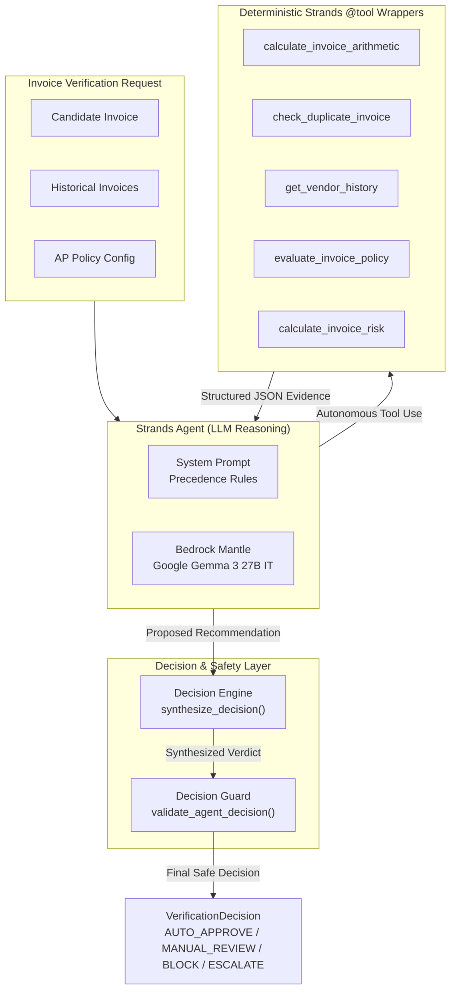
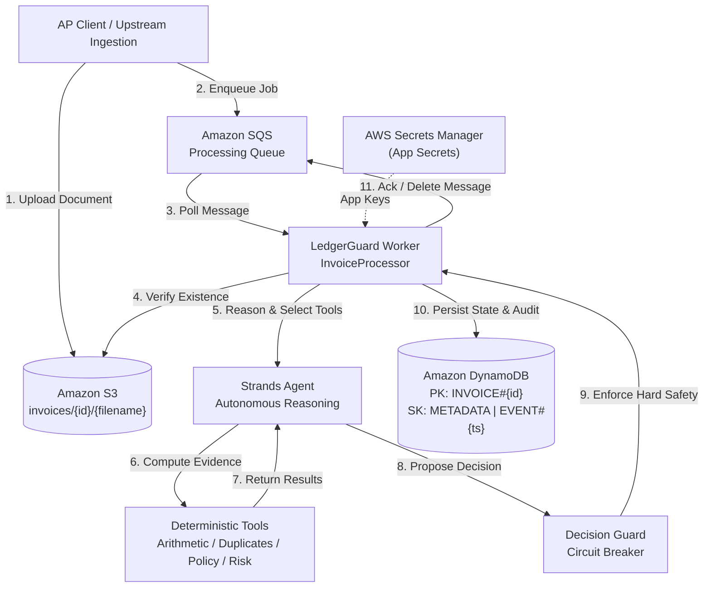
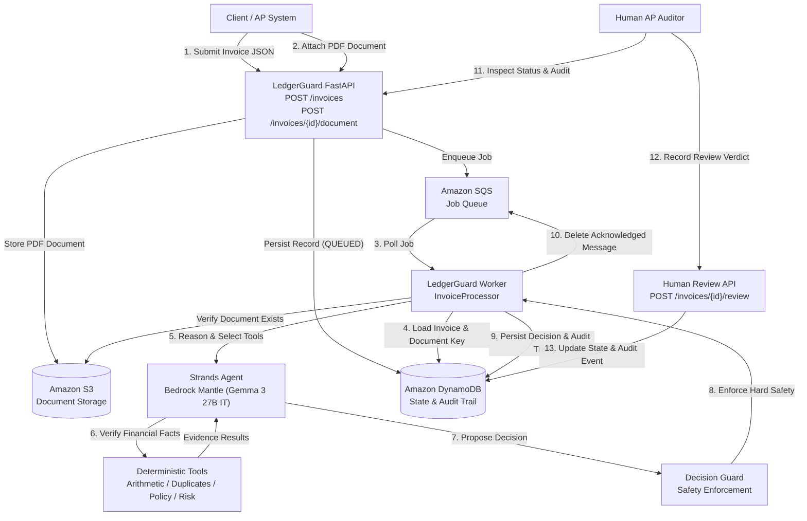

# LedgerGuard

LedgerGuard is an autonomous Accounts Payable (AP) invoice verification agent built with the **Strands Agents SDK**.

Core concept:
> "Let AI handle high-volume, repetitive invoice verification in the background, alerting humans only when genuine judgement is required."

## Architecture

LedgerGuard decouples the core verification agent from the underlying LLM provider through a Model Provider Abstraction layer:

```text
               +-----------------------+
               |   LedgerGuard Agent   |
               |     (Strands SDK)     |
               +-----------------------+
                           |
                           v
               +-----------------------+
               |     Model Factory     |
               +-----------------------+
                           |
                           v
               +-----------------------+
               |  Provider Abstraction |
               +-----------------------+
                 /         |                         /          |                         v           v           v
       +-------------+ +-------------+ +--------------------+
       |   Bedrock   | | OpenRouter  | |   Amazon Bedrock   |
       |   Mantle    | |(Development | |      Runtime       |
       |  (PRIMARY)  | | Alternative)| |(Auth Pending / AWS)|
       +-------------+ +-------------+ +--------------------+
```

- **LedgerGuard Agent**: Accounts-payable verification agent using Strands.
- **Model Factory**: Resolves the model provider from configuration without modifying agent code.
- **BedrockMantleProvider** (*Primary Development Provider*): Connects to Amazon Bedrock Mantle in `us-east-1` running Google Gemma 3 27B IT (`google.gemma-3-27b-it`) with dynamic SigV4-derived bearer tokens minted through AWS IAM credentials.
- **OpenRouterProvider** (*Explicit Alternative Provider*): OpenAI-compatible adapter for OpenRouter (`openai/gpt-4o-mini`) during development.
- **BedrockRuntimeProvider** (*Architectural Provider*): Traditional Amazon Bedrock provider prepared for AWS production deployment.

## Phase 2 ? Deterministic Invoice Verification Engine

**Core Principle**:
> *The LLM reasons over evidence, while deterministic tools verify financial facts.*

In AP invoice verification, AI models reason over unstructured document context and semantics, while all financial arithmetic, policy boundaries, duplicate checks, and risk metrics are verified by deterministic, side-effect-free tools.

### Key Architectural Characteristics
- **Strict Decimal Precision**: All monetary computations are performed using Python's `Decimal` quantized to `Decimal("0.01")` with `ROUND_HALF_UP`. Floating-point representations are strictly forbidden in data models and tools.
- **Multi-Currency Safety**: Monetary amounts are segregated by currency. The system explicitly prevents summing or aggregating across different currency codes without exchange rates.
- **Offline & Autonomous**: Phase 2 tools execute entirely offline without network access, LLM inference, or AWS/cloud dependencies.
- **Tolerant Extraction Modeling**: Incomplete invoices (e.g., partial OCR extraction with `subtotal=None` or `total=None`) are supported without validation errors, returning structured `INSUFFICIENT_DATA` verification statuses.

### Tools & Engines
1. **Invoice Domain Models** (`app/models/invoice.py`): Type-safe Pydantic models for `Invoice` and `LineItem` enforcing Decimal monetary quantities and half-up rounding.
2. **Verification Schemas** (`app/models/verification.py`): Structured enums (`VerificationStatus`, `DuplicateStatus`, `RiskLevel`, `RecommendedAction`) and output models for all verification tools.
3. **Arithmetic Verification Tool** (`app/tools/arithmetic.py`): Evaluates `quantity * unit_price` per line item, subtotal sum accuracy, tax, discount, and expected grand total. Flags `INSUFFICIENT_DATA` if required fields are missing.
4. **Duplicate Detection Tool** (`app/tools/duplicates.py`): Evaluates historical invoices for `CONFIRMED_DUPLICATE` (same vendor and invoice number) and `POSSIBLE_DUPLICATE` (same vendor and total within a 7-day window).
5. **Vendor History Tool** (`app/tools/vendor_history.py`): Computes historical invoice volume, average and maximum spend per currency, date horizons, and recent invoice density without external database dependencies.
6. **Policy Engine** (`app/tools/policy.py`, `app/models/policy.py`): Centralizes corporate AP policy rules (auto-approval limit <= $1,000, high-value ceiling >= $5,000, new vendor review, duplicate payment blocks). Preserves all triggered violations.
7. **Risk Engine** (`app/tools/risk.py`): Computes composite risk score (0?100) from active risk factors, assigns severity levels (`LOW`, `MEDIUM`, `HIGH`, `CRITICAL`), enforces a mandatory critical override for confirmed duplicates, and outputs recommended workflow actions (`AUTO_APPROVE`, `MANUAL_REVIEW`, `BLOCK`).

## Phase 3 — Autonomous Verification Agent

**Core Principle**:
> *The LLM reasons over evidence, while deterministic tools verify financial facts.*

In Phase 3, LedgerGuard connects the 5 deterministic verification tools from Phase 2 into an autonomous Strands Agent architecture with strict decision precedence, safe execution tracking, and a deterministic Decision Guard layer.

### Architectural Principles
- **No Financial Hallucination**: The LLM does not calculate financial truth. Deterministic tools establish financial facts.
- **Autonomous Tool Selection**: The agent inspects candidate invoice data, determines necessary checks, and invokes deterministic tools dynamically.
- **Evidence-Based Reasoning**: Decisions are synthesized from structured tool outputs. The agent cannot override or fabricate verification evidence.
- **Deterministic Decision Guard**: A final safety enforcement layer validates the agent's proposed verdict against hard business rules. Even if the LLM hallucinates an auto-approval, the guard intercepts and enforces safety rules (e.g., confirmed duplicates and critical risk always force a `BLOCK`).

### Architecture Diagram



### Registered Verification Tools
1. **`calculate_invoice_arithmetic`**: Validates line-item math (`quantity * unit_price`), subtotal accumulation, tax, discount, and grand total consistency.
2. **`check_duplicate_invoice`**: Identifies `CONFIRMED_DUPLICATE` (same vendor + invoice number) and `POSSIBLE_DUPLICATE` (same vendor + total within 7 days).
3. **`get_vendor_history`**: Aggregates vendor spend volume, historical transaction counts, and identifies new vendors.
4. **`evaluate_invoice_policy`**: Evaluates corporate limits (auto-approval ceiling <= $1,000, high-value ceiling >= $5,000, new vendor review, duplicate payment block).
5. **`calculate_invoice_risk`**: Computes composite 0-100 risk score, factor weights, risk levels (`LOW`, `MEDIUM`, `HIGH`, `CRITICAL`), and recommended actions.

### Decision Precedence Rules
1. **CONFIRMED_DUPLICATE** -> **`BLOCK`**
2. **Policy Block** -> **`BLOCK`**
3. **CRITICAL Risk** -> **`BLOCK`**
4. **HIGH Risk** -> **`MANUAL_REVIEW`**
5. **Policy Requires Review** -> **`MANUAL_REVIEW`**
6. **MEDIUM Risk** -> **`MANUAL_REVIEW`**
7. **Insufficient Evidence** -> **`MANUAL_REVIEW`**
8. **LOW Risk + All Checks Passed** -> **`AUTO_APPROVE`**

### Decision Guard Enforcement
The Decision Guard acts as a circuit-breaker against model hallucinations. It **never downgrades safety**:
- Confirmed duplicate + Agent proposes `AUTO_APPROVE` -> **Overridden to `BLOCK`**
- Policy block + Agent proposes `MANUAL_REVIEW` -> **Overridden to `BLOCK`**
- Critical risk + Agent proposes `AUTO_APPROVE` -> **Overridden to `BLOCK`**
- Arithmetic `FAIL` + Agent proposes `AUTO_APPROVE` -> **Overridden to `MANUAL_REVIEW`**
- `INSUFFICIENT_DATA` + Agent proposes `AUTO_APPROVE` -> **Overridden to `MANUAL_REVIEW`**

### Observability & Audit Trail
Every verification workflow run records safe execution metadata (`ExecutionMetadata`):
- `agent_run_id`: Unique trace identifier
- `provider`: Model provider (e.g., `bedrock_mantle`)
- `model`: Model identifier (`google.gemma-3-27b-it`)
- `tools_called`: Ordered list of tools actually invoked
- `decision`: Final verified decision
- `risk_level`: Final assessed risk level
- `was_overridden` & `override_reason`: Audit trail of any guard interventions
- *Security*: Excludes all secrets, API keys, credentials, bearer tokens, and sensitive document payloads.


## Phase 4 ? AWS Data Layer + Background Processing

In Phase 4, LedgerGuard is upgraded from a local verification agent to an **AWS-backed background processing system**. Source invoice documents are stored in Amazon S3, processing jobs are queued via Amazon SQS, and verification results along with immutable audit trails are persisted in Amazon DynamoDB.

### Core Principle
> **THE MODEL REASONS. THE TOOLS VERIFY. AWS PROVIDES DURABLE STORAGE AND BACKGROUND EXECUTION.**

The Strands Agent and deterministic tools never manage AWS infrastructure directly; they operate through clean service abstractions.

### Architecture Diagram



### Key Components

1. **Service Interfaces (`app/services/interfaces.py`)**:
   - `DocumentStore`: Document storage contract (upload, download, exists, delete).
   - `InvoiceRepository`: Persistent records, lifecycle states, and chronological audit event logging.
   - `JobQueue`: Asynchronous message publishing, polling with visibility timeout, and acknowledgment.
   - `SecretProvider`: Application secret management.

2. **Amazon S3 Integration (`app/services/s3.py`)**:
   - Stores raw invoice documents under sanitized, traversal-safe keys: `invoices/{invoice_id}/{filename}`.
   - Path traversal prevention (`..`, special characters stripped).

3. **Amazon DynamoDB Integration (`app/services/dynamodb.py`)**:
   - Single-table design:
     - `PK = INVOICE#{invoice_id}`, `SK = METADATA` for invoice entities and verification verdicts.
     - `PK = INVOICE#{invoice_id}`, `SK = EVENT#{timestamp}#{event_id}` for immutable audit trail events.
   - Strict serialization layer converting Decimals, Enums, dates, and Pydantic models safely without float precision loss.
   - Idempotent writes preventing state corruption on repeated execution.

4. **Amazon SQS Integration (`app/services/sqs.py`)**:
   - Job payloads contain only safe metadata (`job_id`, `invoice_id`, `s3_bucket`, `s3_key`). Raw documents and heavy JSON are excluded.
   - Strict transactional acknowledgment: messages are deleted from SQS **only after** DynamoDB persistence succeeds.

5. **AWS Secrets Manager Integration (`app/services/secrets.py`)**:
   - Provider-aware secret retrieval: only queries Secrets Manager when provider is explicitly `openrouter`.
   - Never queries Secrets Manager when using Bedrock Mantle.
   - AWS credentials remain managed exclusively via the standard AWS credential chain.

6. **Background Worker (`app/worker/processor.py` & `app/worker/main.py`)**:
   - `InvoiceProcessor` orchestrates message reception, document checks, verification, Decision Guard validation, durable state persistence, and SQS deletion.
   - Idempotency guard: jobs for invoices already in a terminal state (`AUTO_APPROVED`, `MANUAL_REVIEW`, `BLOCKED`) are safely deduplicated and acknowledged without re-running.
   - Safe logging: logs contain only safe operational metadata (`job_id`, `invoice_id`, status, decision, error category). Raw document bytes, base64 strings, and credentials are never logged.

### Processing Lifecycle States

Invoice processing progresses through the centralized state machine (`app/models/state.py`):
- `RECEIVED` -> Initial ingestion state
- `QUEUED` -> Job published to SQS
- `PROCESSING` -> Worker actively verifying invoice
- `VERIFIED` -> Tools and Decision Guard completed
- `AUTO_APPROVED` -> Clean low-risk invoice approved for payment (Terminal)
- `MANUAL_REVIEW` -> Policy violation, missing data, or medium/high risk requiring human AP review (Terminal)
- `BLOCKED` -> Confirmed duplicate or critical policy/risk violation (Terminal)
- `FAILED` -> System error, missing S3 artifact, or unhandled failure

### AWS Resource Creation Policy

> [!IMPORTANT]
> **Zero Automatic Infrastructure Creation**: The LedgerGuard application and worker will **NEVER** auto-create S3 buckets, DynamoDB tables, or SQS queues at startup. Infrastructure must be provisioned explicitly.

To provision development AWS resources:
```powershell
python scripts/provision_dev.py --confirm
```

Required AWS resources:
- S3 Bucket: `LEDGERGUARD_S3_BUCKET`
- DynamoDB Table: `LEDGERGUARD_DYNAMODB_TABLE` (default: `ledgerguard-invoices`, `PAY_PER_REQUEST` billing)
- SQS Queue: `LEDGERGUARD_SQS_QUEUE_URL` (default: `ledgerguard-invoice-jobs`)
- Secrets Manager Secret (Optional): `OPENROUTER_SECRET_NAME`

### Least-Privilege IAM Policy

For production deployments, the worker execution role requires only the following minimal permissions:

```json
{
  "Version": "2012-10-17",
  "Statement": [
    {
      "Sid": "S3DocumentAccess",
      "Effect": "Allow",
      "Action": [
        "s3:GetObject",
        "s3:PutObject",
        "s3:DeleteObject"
      ],
      "Resource": "arn:aws:s3:::your-ledgerguard-invoices-bucket/*"
    },
    {
      "Sid": "DynamoDBTableAccess",
      "Effect": "Allow",
      "Action": [
        "dynamodb:GetItem",
        "dynamodb:PutItem",
        "dynamodb:UpdateItem",
        "dynamodb:Query"
      ],
      "Resource": "arn:aws:dynamodb:us-east-1:*:table/ledgerguard-invoices"
    },
    {
      "Sid": "SQSJobQueueAccess",
      "Effect": "Allow",
      "Action": [
        "sqs:ReceiveMessage",
        "sqs:DeleteMessage",
        "sqs:SendMessage",
        "sqs:ChangeMessageVisibility"
      ],
      "Resource": "arn:aws:sqs:us-east-1:*:ledgerguard-invoice-jobs"
    },
    {
      "Sid": "SecretsManagerReadAccess",
      "Effect": "Allow",
      "Action": [
        "secretsmanager:GetSecretValue"
      ],
      "Resource": "arn:aws:secretsmanager:us-east-1:*:secret:ledgerguard/*"
    }
  ]
}
```

### Testing Strategy

- **Offline Unit Tests**: All unit tests run fully offline without requiring AWS credentials or network calls:
  ```powershell
  pytest tests -v
  ```
- **Opt-in Live Integration Tests**: Require configured AWS resources and are skipped by default:
  ```powershell
  $env:LEDGERGUARD_RUN_AWS_INTEGRATION = "true"
  pytest tests/integration -v
  ```
- **Live AWS End-to-End Pipeline Script**:
  ```powershell
  python scripts/aws_e2e_test.py
  ```


## Phase 5 ? Live AWS Integration + Document Ingestion + Human Review API

In Phase 5, LedgerGuard upgrades from background processing infrastructure to a fully functional, cloud-backed Accounts Payable verification backend. It integrates live AWS services (Amazon S3, Amazon SQS, Amazon DynamoDB, and Amazon Bedrock Mantle), a production FastAPI application with comprehensive validation, request correlation, and a safe Human Review API.

### Core Principle
> **THE MODEL REASONS. THE TOOLS VERIFY. THE DECISION GUARD PROTECTS. AWS PROVIDES DURABLE EXECUTION AND STATE.**

### End-to-End Flow



### API Endpoints

All endpoints are built with FastAPI, strictly typed schemas, and comprehensive input validation:

| Method | Path | Description | Authentication |
|---|---|---|---|
| `GET` | `/health` | Liveness check returning service status | Unauthenticated |
| `GET` | `/ready` | Readiness probe verifying AWS resource availability | Unauthenticated |
| `POST` | `/invoices` | Ingest structured invoice data, check idempotency, persist to DynamoDB, and enqueue processing job to SQS | Required |
| `POST` | `/invoices/{invoice_id}/document` | Upload invoice document (PDF/PNG/JPEG), validate size (<=10MB), sanitize filename, store in S3, link S3 key, record audit event | Required |
| `GET` | `/invoices/{invoice_id}` | Query current invoice status, decision, risk tier, risk score, and human review verdict | Required |
| `GET` | `/invoices/{invoice_id}/audit` | Retrieve complete, chronological immutable audit trail | Required |
| `POST` | `/invoices/{invoice_id}/review` | Human reviewer intervention on invoices requiring manual review | Required |
| `GET` | `/docs` | Interactive Swagger / OpenAPI documentation | Unauthenticated |
| `GET` | `/openapi.json` | OpenAPI 3.1 JSON specification | Unauthenticated |

### Human Review Workflow

When automated verification flags policy violations, insufficient documentation, or elevated risk, the invoice transitions to `MANUAL_REVIEW`:
1. **Preservation of Automated Findings**: The automated decision (`original_decision`), risk score, and verification details are permanently preserved and never overwritten.
2. **Strict Precondition**: Only invoices with `processing_status == MANUAL_REVIEW` can be reviewed. Attempting to review invoices in `AUTO_APPROVED`, `BLOCKED`, `QUEUED`, or `PROCESSING` returns HTTP 409 Conflict.
3. **Audit Trail**: Every human review action records a `HUMAN_REVIEW_RECORDED` audit event with the reviewer identity, action, review timestamp, and comment.
4. **Controlled Transition**: Action `APPROVE` sets state to `AUTO_APPROVED`; `REJECT` sets state to `BLOCKED`; `ESCALATE` retains `MANUAL_REVIEW` for higher-tier approval.

#
## Phase 6 ?" Hackathon Web Application & Demo Experience

LedgerGuard provides a full-featured, dark-mode web application and interactive operations dashboard built with **React**, **Vite**, and **TypeScript**.

### Key Frontend Capabilities
- **Executive Operations Dashboard**: Displays real-time invoice volume, auto-approval throughput, manual review queues, blocked invoice counts, and aggregate financial totals directly from Amazon DynamoDB.
- **Invoice Directory**: Real-time searchable and filterable table supporting status filtering, pagination, and instant detail inspection.
- **Verification Evidence Panel**: Visualizes structured findings from all 5 deterministic verification tools (Arithmetic validation, Duplicate Detection, Vendor History, Policy Compliance, and Risk Engine).
- **Decision Guard Safety Visualizer**: Explicitly displays the Agent Proposed Decision alongside the Decision Guard protected verdict, highlighting safety overrides when hard business boundaries are enforced.
- **Human-in-the-Loop Review Workflow**: Allows AP auditors to review routed exceptions, choose an audit action (APPROVE, REJECT, REQUEST_INFORMATION), and record audit rationales while preserving the original automated decision.
- **Immutable Audit Timeline**: Displays chronological events (JOB_QUEUED, DOCUMENT_RECEIVED, PROCESSING_STARTED, TOOL_EXECUTED, DECISION_GUARDED, HUMAN_REVIEW_RECORDED) recorded in DynamoDB.
- **Amazon S3 Document Attachments**: Upload and associate documents stored in Amazon S3. *(Transparency Note: Documents are stored in Amazon S3 for audit and manual inspection. OCR and PDF text extraction are not implemented.)*

### Running the Full Application

1. **Backend Server**:
   `powershell
   .\.venv\Scripts\python.exe -m uvicorn app.api.main:app --host 127.0.0.1 --port 8000
   `

2. **Frontend Development Server**:
   `powershell
   cd frontend
   npm run dev
   `
   Open http://127.0.0.1:5173/ in your browser.

3. **Seeding Synthetic Demo Scenarios**:
   `powershell
   .\.venv\Scripts\python.exe scripts/seed_demo.py --seed
   `
   See [docs/demo-runbook.md](docs/demo-runbook.md) for full walkthrough and [docs/video-script.md](docs/video-script.md) for presentation script.


## Enterprise Context Layer (Company Policy, Vendor Master & Approval Matrix)

**Core Principle**:
> *The model reasons over verified company and invoice evidence. Company policies and vendor facts are deterministic.*

The Enterprise Context layer transitions LedgerGuard from evaluating raw invoice fields against generic defaults to evaluating them against configured corporate policy rules and vendor history:

```text
company configuration + vendor master + vendor history + invoice data
  → deterministic evidence
  → policy evaluation
  → risk scoring
  → Strands Agent reasoning
  → Decision Guard
  → final decision
```

### 1. Company Configuration & Policy
- **Demo Corporation**: LedgerGuard Demo Corporation (`LEDGERGUARD-DEMO`).
- **Operational Currencies**: Officially supported in `USD`, `EUR`, `GBP` (default `USD`).
- **Auto-Approval Limit**: `$5,000.00 USD` — Maximum invoice total eligible for straight-through automated approval without manual review.
- **High-Value Threshold**: `$25,000.00 USD` — Invoices exceeding this boundary require executive escalation (Finance Director).
- **Deterministic Enforcement Rules**:
  - Confirmed duplicate invoice → `BLOCK`
  - Arithmetic mismatch discrepancy → `BLOCK`
  - New vendor (0 prior transactions or pending onboarding) → `MANUAL_REVIEW`
  - Missing Purchase Order (when vendor requires PO) → `MANUAL_REVIEW`
  - Unsupported currency → `MANUAL_REVIEW`
  - Excessive discount (> 20.00%) → `MANUAL_REVIEW`
  - Missing mandatory fields (`invoice_number`, `vendor_id`, `vendor_name`, `invoice_date`, `currency`, `line_items`, `subtotal`, `total`) → `MANUAL_REVIEW`

### 2. Approval Routing Matrix
Deterministic corporate authority routing evaluated before straight-through payment processing:
- `$0.00` to `$5,000.00`: `AUTO_APPROVAL_ALLOWED` (straight-through processing eligible)
- `$5,000.01` to `$25,000.00`: `MANAGER_REVIEW` (AP Department Manager authorization required)
- `$25,000.01+`: `FINANCE_DIRECTOR_REVIEW` (Executive review required)
- Confirmed Duplicate: `BLOCK`
- Arithmetic Mismatch: `BLOCK`
- New Vendor / Missing PO: `MANUAL_REVIEW`

### 3. Synthetic Vendor Master & History
Authoritative vendor directory containing synthetic profiles and historical spend baselines (no real bank accounts or secrets):
1. **SuperStore** (`SUPERSTORE-001`): Active, Approved, Bank Verified, PO Required. 127 historical invoices, $157,800 spend, $1,242.52 avg, normal range $100–$5,000 USD.
2. **Apex Cloud Technologies LLC** (`APEX-001`): Active, Approved, Bank Verified, PO Required. 84 historical invoices, $345,000 spend, $4,107.14 avg, normal range $500–$15,000 USD/EUR.
3. **Nova Advisory Partners Inc** (`NOVA-001`): Active, Approved, Bank Verified, PO Optional. 42 historical invoices, $134,400 spend, $3,200 avg, normal range $500–$15,000 USD/GBP.
4. **Northstar Office Systems Ltd** (`NORTHSTAR-001`): Active, Approved, Bank Verified, PO Required. 19 historical invoices, $41,800 spend, $2,200 avg, normal range $200–$6,000 GBP/EUR/USD.
5. **Meridian Industrial Supply Co** (`MERIDIAN-001`): Active, Approved, Bank Verified, PO Required. 58 historical invoices, $92,800 spend, $1,600 avg, normal range $200–$5,000 USD.
6. **New Unverified Supplies LLC** (`NEW-VENDOR-001`): Pending Onboarding, Bank Not Verified, PO Required. 0 historical transactions ($0 spend). Demonstrates new vendor onboarding review.

### 4. Deterministic Risk Scoring
Configurable, evidence-driven multi-factor risk engine:
- `NEW_VENDOR`: +25
- `POLICY_VIOLATION`: +25
- `HIGH_VALUE_INVOICE`: +20
- `AMOUNT_ABOVE_HISTORICAL_RANGE`: +20
- `POSSIBLE_DUPLICATE`: +40
- `MISSING_REQUIRED_FIELD`: +20
- `UNSUPPORTED_CURRENCY`: +25
- `LARGE_DISCOUNT`: +15
- `VENDOR_NOT_APPROVED`: +40
- `ARITHMETIC_MISMATCH`: +50
- `CONFIRMED_DUPLICATE`: 100 (Critical Override)
- Tiers: 0–19 `LOW`, 20–49 `MEDIUM`, 50–74 `HIGH`, 75–100 `CRITICAL`. Capped at 100.

### 5. Decision Precedence & Decision Guard Authority
Preserves deterministic Decision Guard authority over all AI reasoning:
1. `CONFIRMED_DUPLICATE` → `BLOCK`
2. Policy Block (e.g. Arithmetic Mismatch) → `BLOCK`
3. `CRITICAL` Risk (score >= 75) → `BLOCK`
4. `HIGH` Risk (score >= 50) → `MANUAL_REVIEW`
5. Policy Requires Review → `MANUAL_REVIEW`
6. `MEDIUM` Risk (score >= 20) → `MANUAL_REVIEW`
7. Insufficient Data → `MANUAL_REVIEW`
8. `LOW` Risk + All Gates Passed → `AUTO_APPROVE`

## Phase 7: Bulk Invoice Ingestion

LedgerGuard Phase 7 upgrades the ingestion layer from single-invoice submissions to high-throughput, multi-document batch ingestion. It safely handles multiple files, enforces strict security and size constraints, archives documents to S3 under canonical paths, detects duplicates via SHA-256 hashing, persists batch and document metadata in DynamoDB, and dispatches background processing jobs to SQS.

### Core Capabilities

1. **Multi-File Batch Validation**:
   - File format whitelist: `.pdf`, `.png`, `.jpg`, `.jpeg`. Executables and scripts are rejected immediately (`UNSUPPORTED_EXTENSION`).
   - File size ceiling: 10 MB per file (`FILE_TOO_LARGE`).
   - Empty file protection: 0-byte files rejected (`EMPTY_FILE`).
   - Aggregate batch limits: Maximum 100 files, 100 MB total payload per batch.
   - Filename sanitization: Removes path traversal (`../`, `..\`), special characters, and non-alphanumeric noise to prevent S3 key injection.

2. **Content-Addressable Deduplication (Level 1 SHA-256)**:
   - Computes deterministic SHA-256 digests of file contents.
   - Fast lookup against DynamoDB hash index (`DOCHASH#{hash}`).
   - Duplicate documents are safely marked `DUPLICATE` with links to the original document and batch IDs.
   - Duplicate documents are **not** re-uploaded to S3, **not** re-dispatched to SQS, and **never** automatically deleted from source folders.

3. **Canonical S3 Storage Hierarchy**:
   - Single Invoices: `invoices/{invoice_id}/{safe_filename}`
   - Batch Ingestion: `batches/{batch_id}/documents/{document_id}/{safe_filename}`

4. **Batch & Document Lifecycle States**:
   - **Batch Statuses**: `RECEIVED` -> `VALIDATING` -> `UPLOADING` -> `QUEUING` -> `PROCESSING` -> `COMPLETED` / `COMPLETED_WITH_EXCEPTIONS` / `FAILED`.
   - **Document Statuses**: `RECEIVED` -> `VALIDATING` -> `UPLOADING` -> `STORED` -> `QUEUED` / `DUPLICATE` / `REJECTED` / `FAILED`.
   - **Pre-Extraction State**: All Phase 7 documents remain explicitly in `AWAITING_EXTRACTION`. No OCR, field parsing, or synthetic invoice values are fabricated.

5. **REST API Endpoints**:
   - `POST /batches`: Initialize a batch metadata record.
   - `POST /batches/upload`: Multipart bulk upload of multiple documents.
   - `GET /batches`: Paginated listing of ingestion batches.
   - `GET /batches/{batch_id}`: Batch detail view with aggregate counters and document records.
   - `GET /batches/{batch_id}/documents`: List of documents within a specific batch.

6. **Local Folder Ingestion CLI (`scripts/ingest_batch.py`)**:
   - Scans target directories for supported invoice documents.
   - Secure authentication: Reads `LEDGERGUARD_API_KEY` from the environment. **Never** requires or exposes API keys via visible command-line arguments (e.g. `--api-key`).
   - Usage:
     ```powershell
     python scripts/ingest_batch.py --folder demo_batch
     ```

7. **Frontend Operations UI**:
   - **Bulk Ingestion View**: Multi-file drop zone, client-side validation, upload progress, and immediate results.
   - **Batches Overview View**: Chronological table of all batches with status badges, source, and document counts.
   - **Batch Detail View**: Deep-dive into batch documents, SHA-256 hashes, duplicate match explanations, and S3 keys.

## Security Model

- **Authentication Boundary**: Protected endpoints require API authentication via `X-API-Key` header or `Authorization: Bearer <key>`.
- **Masked Error Responses**: Unhandled exceptions, AWS error payloads, and internal stack traces are caught by API middleware and masked. Safe structured errors are returned with a unique `X-Request-ID`.
- **Safe Path & Document Handling**: File uploads sanitize filenames using `os.path.basename` and regex stripping of unsafe characters, preventing path traversal attacks.
- **Upload Limits**: File uploads exceeding `MAX_DOCUMENT_SIZE_BYTES` (default: 10MB) are rejected with HTTP 413 Payload Too Large.
- **Strict Decimal Precision**: Monetary numbers are validated as strings or integers and parsed into `Decimal`. Floating-point values are rejected with HTTP 422 to prevent rounding exploits.
- **Credential Hygiene**: Zero hardcoded credentials. AWS credentials use the standard AWS credential chain (`~/.aws/credentials`, IAM roles, or environment variables).

### Known Limitations

> [!IMPORTANT]
> - **OCR Is Not Implemented**: LedgerGuard does not currently extract text from raw invoice images or scanned PDFs via OCR.
> - **Structured Data Dependency**: Source PDF documents are stored durably in Amazon S3 for compliance and manual auditor reference; however, automated verification and AI reasoning currently operate on the structured JSON data provided at ingestion (`POST /invoices`).
> - **No Direct PDF Parsing**: Verification tools analyze the structured financial fields (line items, tax, vendor, totals). Binary PDF parsing will be introduced in future phases.

### Quickstart & Startup Commands (Windows / PowerShell)

#### 1. Start Local API Server
```powershell
# In virtual environment:
uvicorn app.api.main:app --reload --port 8000
```
Interactive API docs are available at `http://localhost:8000/docs`.

#### 2. Start Background Worker
```powershell
python -m app.worker.main
```

#### 3. Run Offline Test Suite (Zero AWS calls, no cost)
```powershell
pytest tests -v
```

#### 4. Run Live AWS Integration Tests (Requires AWS access)
```powershell
$env:LEDGERGUARD_RUN_AWS_INTEGRATION = "true"
pytest tests/integration -v
```

#### 5. Run Live End-to-End Pipeline Verification
```powershell
$env:PYTHONPATH = "."
$env:LEDGERGUARD_RUN_AWS_INTEGRATION = "true"
python scripts/phase5_e2e.py
```

## Model Strategy & AWS Status

- **Primary Development Provider**: Amazon Bedrock Mantle
  - Model: Google Gemma 3 27B IT
  - Model ID: `google.gemma-3-27b-it`
  - Region: `us-east-1`
  - Endpoint Family: `bedrock-mantle`
  - Auth: AWS IAM credentials via standard credential chain (`ledgerguard` profile / `ledgerguard-dev` IAM identity)
- **Alternative Provider**: OpenRouter (`openai/gpt-4o-mini`) via explicit configuration.
- **Future / Currently Restricted Provider**: Traditional Amazon Bedrock Runtime (`amazon.nova-lite-v1:0`).
  - *Status*: Awaiting AWS Support account authorization resolution (`authorizationStatus = NOT_AUTHORIZED`, Case 178842133900178).
  - Traditional Bedrock Runtime provider construction executes zero network calls and zero model inference during development.

> [!NOTE]
> Provider selection is strictly explicit via `LEDGERGUARD_MODEL_PROVIDER`. There is **no automatic fallback** between providers.

## Local Development Setup

### Prerequisites
- Python 3.11+
- Virtual environment (`.venv`)
- Configured AWS profile (`ledgerguard`) for Bedrock Mantle

### Setup Instructions

1. Activate the virtual environment:
   ```powershell
   .\.venv\Scripts\Activate.ps1
   ```

2. Configure environment variables:
   Copy `.env.example` to `.env`:
   ```powershell
   Copy-Item .env.example .env
   ```
   Edit `.env` to supply your configuration:
   ```env
   # Primary Development Provider: Amazon Bedrock Mantle
   LEDGERGUARD_MODEL_PROVIDER=bedrock_mantle
   BEDROCK_MANTLE_MODEL_ID=google.gemma-3-27b-it
   AWS_REGION=us-east-1
   AWS_PROFILE=ledgerguard

   # Explicit Alternative Provider: OpenRouter
   # LEDGERGUARD_MODEL_PROVIDER=openrouter
   # OPENROUTER_API_KEY=<your-key>
   # OPENROUTER_MODEL_ID=openai/gpt-4o-mini
   # OPENROUTER_BASE_URL=https://openrouter.ai/api/v1

   # Blocked Traditional Bedrock Runtime (Awaiting Account Authorization)
   # LEDGERGUARD_MODEL_PROVIDER=bedrock_runtime
   # BEDROCK_MODEL_ID=amazon.nova-lite-v1:0
   # BEDROCK_PROFILE_NAME=ledgerguard
   ```

3. Run Unit Tests:
   Unit tests execute offline without external network access or Bedrock token consumption:
   ```powershell
   pytest tests -v
   ```

## Run Smoke Test

The real-model smoke test verifies end-to-end integration across Strands, the provider abstraction, and the live Google Gemma 3 27B IT model on Amazon Bedrock Mantle:

```powershell
python scripts/mantle_smoke_test.py
```

Expected output on successful verification:
```text
========================================
LEDGERGUARD BEDROCK MANTLE SMOKE TEST
========================================

Provider: Bedrock Mantle
Model: google.gemma-3-27b-it
Region: us-east-1
AWS Identity: ledgerguard-dev

Strands initialization: PASS
AWS credential resolution: PASS
Bedrock Mantle initialization: PASS
Real model invocation: PASS
Real response: PASS

Response:
LedgerGuard Bedrock Mantle verification passed.

========================================
BEDROCK MANTLE: PASS
========================================
```

## Security

- Secrets and credentials must only be provided via environment variables or `.env`.
- `.env` and credential files are excluded in `.gitignore` and must never be committed.
- Sensitive values (e.g., API keys) are managed via Pydantic `SecretStr` to prevent accidental logging or exposure.
- AWS authentication uses the standard AWS credential chain without hardcoded keys.

## License

This project is licensed under the MIT License. See [LICENSE](LICENSE) for details.
